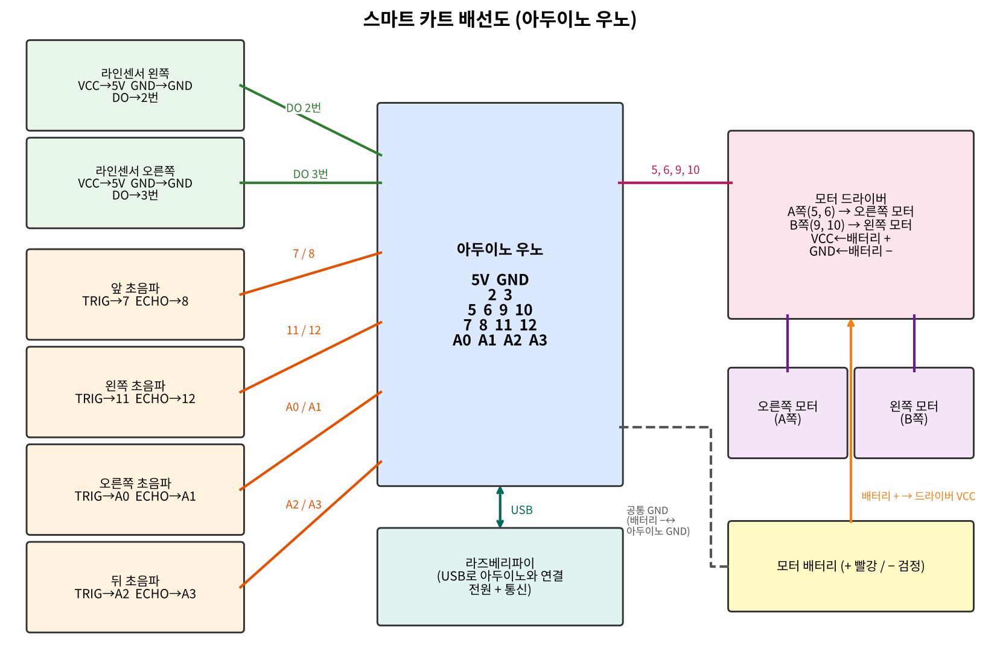

# 공항 자율주행 스마트 카트 (바퀴친구들)

일반인과 노약자를 위한 공항 이동 보조 카트 **프로토타입**입니다.
탑승권(게이트 번호)을 입력하면 카트가 바닥의 라인을 따라 게이트까지 이동하고, 장애물이 가까워지면 멈췄다가 장애물이 사라지면 다시 출발합니다.

- 팀: 바퀴친구들 (서재희, 김예린, 최가온, 한정민) / ToI모빌리티 트랙
- 융합보안 요소: HMAC 서명 QR 검증(위조·변조 QR 차단), 먼저 찍은 폰만 조종하는 세션 점유 잠금, 로봇 전용 주소를 파이 안(127.0.0.1)으로 제한, 비밀값 환경변수 분리



---

## 1. 전체 구조와 역할

| 장치 | 하는 일 |
|---|---|
| 아두이노 우노 | 라인센서 읽기, 라인 따라가기(모터 제어), 초음파 4개 거리 측정, 거리값을 파이로 전송, 자체 안전 정지, 파이의 정지/출발 명령 실행 |
| 라즈베리파이 | 거리값으로 칼만필터, 충돌시간(TTC), 위험 단계를 판단하고 정지(`S`)/재출발(`G`) 명령 전송 |
| 웹 서버 (Flask) | 카트 QR 서명 검증, 폰 점유 잠금, 탑승구 선택, 카트 상태(위험 단계, TTC, 진행률) 표시, 반납 |
| `cart_bridge.py` (파이) | 웹의 명령(출발/정지)을 읽어 카트를 제어하고, 카트 상태를 웹에 보고. 시리얼 포트는 이 프로그램만 엶 |

아두이노와 파이는 **USB 선 하나**로 전원과 통신(시리얼 9600)을 함께 합니다.

```
초음파 4개 ─┐
            ├─ 아두이노 ──(USB 시리얼)── 라즈베리파이 (칼만필터 / TTC 판단)
라인센서 2개 ┘     │                              │
                  모터 드라이버 ← 모터 배터리      └─ 정지(S) / 재출발(G) 명령
```

> 웹과 카트는 **프로세스 2개**로 나뉘어 파이 안에서 HTTP(127.0.0.1:5000)로만 연결됩니다. 웹은 시리얼을 열지 않아서 포트 충돌이 없습니다. 자세한 흐름: [`docs/web_link.md`](docs/web_link.md). 가짜 시리얼 테스트는 통과했고, 실제 카트 연동 시험은 진행 중입니다.

---

## 2. 사용 부품

- 아두이노 우노 1, 라즈베리파이 1 (카메라 모듈로 사람 감지)
- 초음파 센서 HC-SR04 4개 (앞, 왼쪽, 오른쪽, 뒤)
- IR 라인센서 2개 (왼쪽, 오른쪽)
- 모터 드라이버(A-1A, A-2A, B-1A, B-2A 입력) 1, DC 모터 2, 모터용 배터리, 브레드보드, 점퍼선

---

## 3. 배선

핀 연결표 전체: [`docs/pin_table.md`](docs/pin_table.md)

| 구분 | 연결 |
|---|---|
| 초음파 (TRIG/ECHO) | 앞 7/8, 왼쪽 11/12, 오른쪽 A0/A1, 뒤 A2/A3 (VCC 5V, GND) |
| 라인센서 (OUT) | 왼쪽 2, 오른쪽 3 (VCC 5V, GND) |
| 모터 드라이버 입력 | A-1A 5, A-2A 6, B-1A 9, B-2A 10 |
| 모터 전원 | 드라이버 VCC → 모터 배터리 +, GND → 배터리 −와 아두이노 GND (공통 접지) |

- 아두이노는 5V 신호라 초음파 ECHO에 분압 저항이 필요 없습니다.
- **센서 VCC는 아두이노 5V, 모터 드라이버 VCC는 모터 배터리 +** 입니다. 서로 섞어 연결하지 않습니다.
- 바퀴가 뒤로 돌고 좌우가 바뀌어 있어서, 배선은 그대로 두고 코드에서 `LEFT_PIN1=10, LEFT_PIN2=9, RIGHT_PIN1=6, RIGHT_PIN2=5`로 지정했습니다.

### 배선 사진

(촬영 후 `photos/` 폴더에 넣고 이곳에 연결합니다.)

---

## 4. 코드 설명

### 4-1. 아두이노 (`arduino/cart_main/cart_main.ino`)

1. **라인 따라가기**: 두 센서가 모두 검정이면 직진, 한쪽만 검정이면 그쪽 바퀴를 멈춰 보정합니다. 검정에서 찍히는 값은 `BLACK_L`, `BLACK_R`로 센서마다 지정합니다.
   - **급커브 복구**: 한쪽 센서가 마지막으로 라인을 본 직후 둘 다 흰색이 되면, 그쪽으로 제자리 회전(`SEARCH_SPEED`)하며 라인을 다시 찾습니다. 3초 안에 못 찾거나 직선 끝에서 놓친 경우에는 정지합니다.
2. **바퀴 속도**: 왼쪽 바퀴가 더 느려서 `leftSpeed=170`, `rightSpeed=150`으로 따로 지정했습니다. 시리얼 모니터에서 `+`/`-`로 왼쪽 속도를 5씩 바꿔 가며 직진이 곧게 되는 값을 찾을 수 있습니다.
3. **거리 측정**: 초음파 4개를 한 번에 하나씩(25ms 간격) 재서 100ms마다 전송합니다. 최대 측정 거리는 데모용으로 좁게 앞 80cm, 왼쪽/오른쪽/뒤 60cm이고 그보다 먼 값은 `-1`입니다. (`MAX_CM`)
4. **자체 안전 정지**: 앞 20cm 이하 또는 옆 8cm 이하가 연속 2번 측정되면 파이 명령과 상관없이 정지(`SAFE:STOP`)합니다. 앞이 30cm보다 멀어지면 해제(`SAFE:GO`)하고, 옆 때문에 멈춘 경우에는 옆이 12cm보다 멀어야 해제됩니다. 뒤 센서는 정지에 쓰지 않습니다.
5. **통신 (시리얼 9600)**
   - 아두이노 → 파이: `D:앞,왼,오,뒤` (cm, 측정 실패 `-1.0`)
   - 파이 → 아두이노: `S` 정지(`ACK:S`), `G` 출발(`ACK:G`), `I` 라인센서 값 출력, `+`/`-` 왼쪽 속도 조절

`arduino/wiring_check/wiring_check.ino`는 배선 확인용입니다. 센서 값을 0.5초마다 출력하고 `L`/`R`/`B`/`S` 명령으로 모터를 1초씩 시험합니다. (바퀴를 띄우고 사용)

### 4-2. 라즈베리파이 (`raspberry_pi/`)

- `week1_obstacle_logic.py`: 칼만필터, TTC, 방향별 위험 단계, 연속 3프레임 확인, 긴급 제동 후 1초 억제, 우선순위 판단을 담은 **판단 로직**입니다. 직접 실행하면 모의 센서값으로 검증합니다.
- `pi_obstacle_stop4.py`: 아두이노의 거리 4개를 로직에 넣어 위험(HIGH 이상)이면 `S`를 보내고, 앞이 30cm보다 멀어진 상태가 0.5초 이어지면 `G`를 보냅니다. 뒤는 정지에 쓰지 않습니다.
- `pi_sensor_test.py`: 초음파 4개와 라인센서 값을 파이 화면에서 확인하는 시험용입니다. (판단은 하지 않음)
- `yolo_detector.py`: 파이 카메라로 사람(person)을 감지해 최신 결과(`person`, `count`, `max_area`, `fps`)를 쓰레드로 갱신합니다. 단독 실행(`python3 yolo_detector.py`)으로 사람 수와 박스 크기(%)를 확인할 수 있습니다. `max_area`는 화면에서 사람 박스가 차지하는 비율이라 클수록 가깝습니다.
- `main.py`: 초음파 + 라인 이탈 감시 + 카메라(YOLO 사람 감지)를 합친 통합 판단입니다. 초음파 위험(앞 20cm/옆 8cm 이하), 가까운 사람(카메라), 라인 이탈(둘 다 흰색 4초 이상) 중 하나라도 해당하면 `S`, 앞이 30cm보다 멀고 위험이 없으면 `G`를 보냅니다. YOLO는 `yolo_detector.py`(파이 카메라 모듈 + `ultralytics`의 yolo11n, person 클래스)가 있을 때만 켜지고, 없거나 켜지 못하면 초음파와 라인만으로 동작합니다.

위험 기준 거리와 TTC 계산 예시: [`docs/risk_and_ttc.md`](docs/risk_and_ttc.md)

- `cart_bridge.py`: 웹의 `/robot/command`를 0.1초마다 읽어 출발 허가(`driving`/`returning`)가 있을 때만 `main.py`의 판단(`Brain`)으로 달리게 하고, 위험 단계·TTC·진행률을 `/robot/status`로 보고합니다. 웹 연결이 끊기면 안전하게 정지합니다. `USE_YOLO = True`이면 카메라로 사람이 화면의 `PERSON_AREA_STOP`(기본 30%) 이상으로 크게 보일 때도 정지하고, 사라지면 재출발합니다. `TRIP_SECONDS`(출발점→게이트), `RETURN_LAP_SECONDS`(게이트→출발점, 우회 통로)를 시간으로 재서 넣으면 도착과 자동 반납이 동작합니다. (시간 기반 단순화)

### 4-3. 웹과 QR (`web/`)

- `qr_signature.py`: 카트 번호와 비밀키(`CART_SECRET`)로 HMAC-SHA256 서명을 만들고 검증합니다. 변조된 QR은 거부됩니다.
- `cart_web.py`: 카트 QR을 찍으면 서명을 확인하고 그 폰이 카트를 **점유**합니다(다른 폰은 "사용 중"). 점유한 폰만 탑승구 선택과 반납이 가능하고, 10분 동안 아무 요청이 없으면 잠금이 풀립니다. 로봇 전용 주소(`/robot/*`)는 파이 안에서만 접근할 수 있습니다.
- `make_cart_qr.py`: 카트 뒤에 붙일 서명된 QR 주소와 이미지를 만듭니다.
- `test_cart_web.py`: 서명 검증, 점유, 비상정지 권한, 로봇 주소 접근 제한, 반납을 확인하는 자동 테스트 27항목입니다.

> 공항 이용자가 아이디/비밀번호로 로그인하는 것은 현실적이지 않아서 **로그인 대신 서명 QR + 세션 점유 잠금**으로 인증합니다. 한계: QR을 먼저 찍은 폰이 카트를 차지하므로 카트 앞에 있는 사람만 찍을 수 있다는 가정이 필요하며, 실제 서비스라면 카트 손잡이의 물리 버튼이나 근접 확인을 더해야 합니다.

---

## 5. 실행 방법

### 아두이노
1. Arduino IDE에서 `arduino/cart_main/cart_main.ino`를 엽니다.
2. `BLACK_L`, `BLACK_R`, `leftSpeed`, `rightSpeed`를 실제 값에 맞춥니다.
3. 보드 Arduino Uno와 포트를 선택해 업로드합니다. **바퀴를 띄운 상태**로 시작합니다. (전원을 넣고 5초 뒤 라인추종이 시작됩니다)

### 라즈베리파이
```bash
pip install -r requirements.txt
ls /dev/ttyACM*                                   # 아두이노 포트 확인
python3 raspberry_pi/pi_obstacle_stop4.py /dev/ttyACM0   # 초음파만으로 정지/재출발
python3 raspberry_pi/main.py /dev/ttyACM0                # 초음파 + 라인 이탈 + (YOLO) 통합
```
연결 후 5~6초 기다리면 시작합니다. 라인 없이 시험할 때는 `main.py`의 `USE_LINE_LOST = False`, YOLO를 안 쓸 때는 `USE_YOLO = False`로 바꿉니다.
**웹 + 카트를 함께 실행할 때** (터미널 2개, 같은 파이에서):
```bash
# 터미널 1: 웹
cd web
export CART_SECRET="길고-무작위한-문자열" FLASK_SECRET="다른-길고-무작위한-문자열"
CART_SIM=0 python3 cart_web.py            # CART_SIM=1(기본)이면 카트 없이 화면만 시험
# QR 만들기 (같은 CART_SECRET, 파이 IP는 hostname -I)
python3 make_cart_qr.py 07 http://<파이 IP>:5000   # cart_07_qr.png 를 카트 뒤에 붙임

# 터미널 2: 카트
cd raspberry_pi
python3 cart_bridge.py /dev/ttyACM0
```
폰과 파이는 같은 와이파이(또는 폰 핫스팟)에 있어야 하고, 폰으로 QR을 찍으면 탑승구 선택 화면이 열립니다. 카메라(YOLO)는 `cart_bridge.py` 위쪽의 `USE_YOLO`로 켜고 끕니다. 카메라는 한 프로그램만 쓸 수 있어서 `yolo_detector.py` 단독 실행은 끄고 시작합니다.

시리얼 포트는 한 프로그램만 열 수 있어서 `pi_sensor_test.py`, `pi_obstacle_stop4.py`, `main.py`를 동시에 실행하면 안 됩니다. 아두이노 IDE의 시리얼 모니터도 닫고 실행합니다.

### 웹 (비밀값 설정)
비밀값은 코드에 없고 환경변수로만 받습니다. 설정이 없으면 실행되지 않습니다. 값을 바꾸면 QR을 다시 만들어야 합니다.
```bash
export CART_SECRET="길고-무작위한-문자열"       # QR 서명 키
export FLASK_SECRET="다른-길고-무작위한-문자열"  # 세션 키
# 무작위 문자열 만들기: python3 -c "import secrets; print(secrets.token_hex(16))"
cd web && python3 test_cart_web.py            # 자동 테스트 (테스트 전용 임시 값을 사용)
cd ../raspberry_pi && python3 test_cart_integration_friendweb.py   # 웹 + cart_bridge 통합 시험 (가짜 시리얼)
```

---

## 6. 테스트 기록 (직접 채우기)

- [ ] 초음파 4개 각각 자와 비교해 거리가 비슷한가
- [ ] 라인센서 값 (흰색 / 검정): 왼쪽 __ / __ , 오른쪽 __ / __
- [ ] 직선, 커브 라인 따라가기
- [ ] 앞 장애물에서 정지, 치우면 재출발
- [ ] 옆, 뒤 센서 동작
- [ ] 웹: QR 찍고 탑승구 선택 → 카트 출발
- [ ] 웹 화면에 위험 단계·TTC 표시, 장애물 정지/재출발
- [ ] 카메라: 사람 박스 크기(%) 측정(사진 기준 39~50%에서 인식), 주행 중 사람 사진 앞에서 정지/재출발, 기준값(`PERSON_AREA_STOP`) 확정
- [ ] 도착 후 정지, 반납 → 우회 통로 복귀 (시간 측정값: TRIP_SECONDS __ / RETURN_LAP_SECONDS __)

---

## 7. 한계와 향후 과제

- 프로토타입에서는 경로 추종을 바닥 라인으로 단순화했습니다. 실제 공항에서는 바닥 QR 마커, UWB 같은 위치 기반 방식, 카메라 기반 내비게이션으로 확장하는 것을 전제로 합니다.
- 장애물 앞에서는 정지와 대기를 기본으로 하고, 우회 주행은 후속 과제입니다.
- 실제 크기의 카트에 적용하려면 속도에 맞춘 제동 거리와 반응 시간 보정, 더 먼 거리를 보는 센서가 필요합니다. (HC-SR04는 약 2m 이내)
- 초음파는 반사 환경(재질, 각도)에 따라 값이 튈 수 있어 칼만필터와 연속 프레임 확인으로 보완했습니다.
- 도착과 복귀는 센서가 아니라 **주행 시간**으로 판단하는 단순화입니다. (게이트 앞 정지, 출발점 정지) 배터리가 줄면 위치가 어긋날 수 있어 실제로는 바닥 마커나 카메라가 필요합니다.
- 복귀는 게이트 뒤로 이어지는 우회 통로(순환 라인)를 따라 앞으로 달리는 방식입니다. 게이트별(A/B) 분기 경로는 후속 과제입니다.
- 카메라(YOLO)는 사진으로 시험한 사람 감지를 정지 판단의 보조(먼 거리)로 쓰며, 실제 사람과 다양한 환경에서의 성능은 검증하지 않았습니다. 아두이노-파이 무선 통신은 후속 과제입니다.

---

## 8. 겪었던 어려움

개발 중 막혔던 문제와 해결 과정은 [`docs/TROUBLESHOOTING.md`](docs/TROUBLESHOOTING.md)에 정리했습니다.

---

## 9. 폴더 구조

```
airport-smart-cart/
├─ README.md
├─ requirements.txt
├─ .env.example
├─ docs/            # 배선도, 핀 표, 위험 기준과 TTC 계산, 웹 연동, 트러블슈팅, 트랙 도면, CHANGELOG
├─ photos/          # 배선·시연 사진
├─ arduino/
│   ├─ cart_main/cart_main.ino
│   └─ wiring_check/wiring_check.ino
├─ raspberry_pi/
│   ├─ week1_obstacle_logic.py
│   ├─ pi_obstacle_stop4.py
│   ├─ pi_sensor_test.py
│   ├─ main.py
│   ├─ yolo_detector.py                    # 카메라 사람 감지
│   ├─ cart_bridge.py                      # 웹 <-> 카트 연결
│   ├─ test_cart_bridge.py
│   ├─ test_cart_integration_friendweb.py
│   └─ test_cart_yolo.py
└─ web/
    ├─ cart_web.py
    ├─ qr_signature.py
    ├─ make_cart_qr.py
    └─ test_cart_web.py
```
